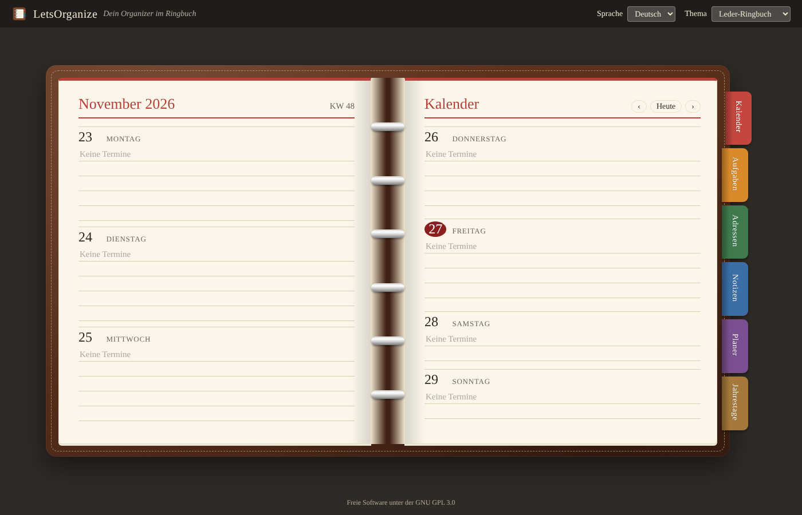
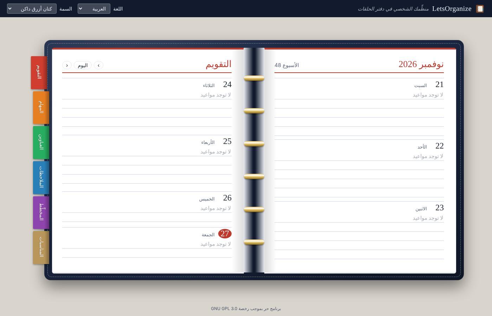

# LetsOrganize

Ein persönlicher Organizer im Browser, der aussieht wie ein hochwertiges Leder-Ringbuch mit farbigen Registern – angelehnt an das klassische Organizer-Gefühl von früher, aber mit moderner Technik: Abgleich mit Google Kalender, Google Kontakte und Google Tasks (in Arbeit).



*A personal organizer in the browser that looks like a classic leather ring binder with coloured section tabs, with sync to Google Calendar, Contacts and Tasks (work in progress). English summary below.*

## Stand

Grundgerüst (Phase 1 der [Roadmap](docs/ROADMAP.md)):

- Go-Server, eine einzige Programmdatei, lokal startbar und später im Container betreibbar
- Ringbuch-Oberfläche mit Registern Kalender, Aufgaben, Adressen, Notizen, Planer, Jahrestage
- Wochenansicht als Doppelseite und Jahresplaner (noch ohne Daten)
- **Themen**: Aussehen frei gestaltbar, eigene Themen per Datei
- **Mehrsprachig** von Anfang an: Deutsch, Englisch, Arabisch – inklusive Rechts-nach-links-Darstellung



## Starten

Voraussetzung: [Go](https://go.dev/dl/) ab Version 1.26.

```sh
go run .
```

Dann im Browser <http://127.0.0.1:8470> öffnen. Die Daten liegen in `letsorganize.db` im Datenordner (SQLite).

Optionen:

| Option | Bedeutung | Standard |
| --- | --- | --- |
| `-addr` | Adresse und Port | `127.0.0.1:8470` |
| `-data` | Ordner für Daten und eigene Themen | `%AppData%\LetsOrganize` bzw. `~/.config/LetsOrganize` |

Der Datenordner lässt sich auch über die Umgebungsvariable `LETSORGANIZE_DATA` festlegen.

Bauen unter Windows:

```powershell
powershell -ExecutionPolicy Bypass -File .\Werkzeuge\bauen.ps1
```

Tests:

```sh
go test ./...
```

## Google-Abgleich

Deine Google-Kalender werden in beide Richtungen abgeglichen (welche, stellst du im Google-Dialog ein) – alle fünf Minuten und auf Knopfdruck (Knopf „Google“ oben rechts). Kontakte und Aufgaben folgen. Den nötigen eigenen Google-Zugang beschreibt [docs/GOOGLE-EINRICHTUNG.md](docs/GOOGLE-EINRICHTUNG.md).

Das Google-Token liegt verschlüsselt in der Datenbank; der Schlüssel `secret.key` liegt im Datenordner. Den Datenordner daher nicht in geteilte Cloud-Ordner legen.

## Themen

Ein Thema ist ein Ordner mit einer `theme.json`. Mitgeliefert werden `themes/leder-ringbuch` (Standard) und `themes/nachtblau-leinen`. Eigene Themen kommen in den Unterordner `themes` des Datenordners; ein eigenes Thema mit gleicher ID ersetzt das mitgelieferte.

```json
{
  "id": "mein-thema",
  "name": { "de": "Mein Thema", "en": "My theme" },
  "colors": { "cover": "#6b3a22", "paper": "#fbf6e9", "...": "..." },
  "fonts": { "body": "Georgia, serif", "heading": "Georgia, serif", "hand": "cursive" },
  "tabs": { "calendar": "#b5413a", "todo": "#d98a2b", "...": "..." },
  "tabShape": "rounded",
  "paper": { "calendar": "diary", "notes": "lined", "planner": "plain" }
}
```

- `colors`, `fonts`, `tabs`: werden zu CSS-Variablen (`--lo-color-cover` usw.). Fehlende Werte kommen aus dem Standardthema.
- `tabShape`: `rounded`, `square` oder `notched`
- `paper` je Abschnitt: `plain`, `lined`, `grid`, `dotted` oder `diary` – wie nachkaufbare Einlagen
- Ein Thema enthält **keine Texte**. Beschriftungen kommen immer aus den Sprachdateien, damit jedes Thema in jeder Sprache funktioniert.
- Alle Werte werden beim Laden streng geprüft; ein Thema kann kein fremdes CSS oder Skript einschleusen.

## Sprachen

Jede Sprache ist eine Datei in `locales/`, z. B. `de.json`:

```json
{
  "meta": { "name": "Deutsch", "dir": "ltr", "weekStart": 1 },
  "messages": { "tab.calendar": "Kalender", "...": "..." }
}
```

- `dir`: `ltr` oder `rtl` (Schreibrichtung). Bei `rtl` wird das ganze Ringbuch gespiegelt: Register links, Blättern in Gegenrichtung.
- `weekStart`: erster Wochentag (0 = Sonntag, 1 = Montag, 6 = Samstag)
- Datum, Monatsnamen und Zahlen kommen aus dem Browser (`Intl`) in der gewählten Sprache.
- Fehlende Texte fallen auf Englisch zurück; `go test ./...` meldet unvollständige Sprachdateien.

Neue Übersetzungen sind willkommen: `locales/en.json` kopieren, übersetzen, Pull Request stellen.

Für die Oberfläche gilt: nur logische CSS-Eigenschaften (`margin-inline-start` statt `margin-left` usw.), damit Rechts-nach-links ohne Sonderfälle funktioniert.

## Aufbau

```
main.go, assets.go     Programmstart, eingebettete Dateien
internal/server        Weboberfläche und Schnittstellen
internal/i18n          Sprachdateien
internal/store         Datenbank, Migrationen, Benutzer
internal/recur         Wiederholungsregeln (RRULE)
internal/google        Anmeldung bei Google und Abgleich
internal/secret        Verschlüsselung der Tokens
internal/store/migrations  Schema als nummerierte SQL-Dateien
internal/themes        Themen
locales/               Übersetzungen
themes/                mitgelieferte Themen
web/                   HTML, CSS, JavaScript
docs/                  Roadmap und Bilder
```

## English summary

LetsOrganize is a browser-based personal organizer with the look and feel of a classic leather ring binder. It is a single Go binary (`go run .`, then open <http://127.0.0.1:8470>). Appearance is fully themeable via `theme.json` files, and the UI is multilingual from the start, including right-to-left languages. Google Calendar, Contacts and Tasks sync and import of old organizer data (CSV) are planned – see [docs/ROADMAP.md](docs/ROADMAP.md).

LetsOrganize is not affiliated with or endorsed by HCL or IBM. “Lotus” and “Lotus Organizer” are trademarks of their respective owners.

## Lizenz

Copyright (C) 2026 Andreas "Nupela Didiman" Neugebauer

Freie Software unter der [GNU General Public License 3.0](LICENSE) oder einer späteren Version.
